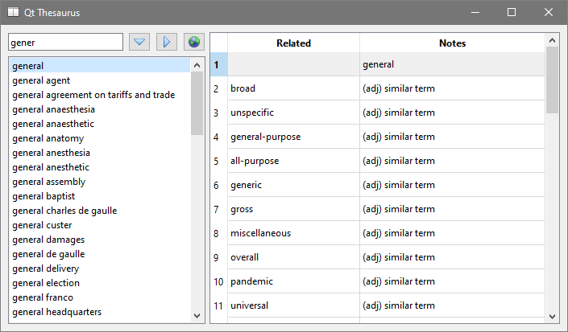

# sdm_thesaurus_qt6

A project demonstrating how to use SQL DAL Maker + Qt6/C++ (CLion, NetBeans 11.2+ with C++ plugin,
VS Code). RDBMS is SQLite3.



## The data layer

`sdm/sdm.xml` describes the models and the DAO, `sdm/settings.xml` the database (`thesaurus.sqlite`)
and the type map. The headers `Word.h`, `RelatedWord.h`, `ThesaurusDao.h` and the data store
`DataStore.h`/`DataStore.cpp` are generated by any of:

- [SQL DAL Maker for IntelliJ Platform](https://plugins.jetbrains.com/plugin/7092): CLion and the
  other JetBrains IDEs
- [SQL DAL Maker for Eclipse](https://marketplace.eclipse.org/content/sql-dal-maker)
- [sdmc](https://github.com/panedrone/sdmc), the command-line twin of the plug-ins: the same
  `sdm.xml` and `settings.xml`, the same generated code, no IDE needed. In the project folder:

```bash
sdmc gen     # regenerate the headers
sdmc val     # check that they are up to date
sdmc ds      # update DataStore.h and DataStore.cpp to the version of sdmc
```

Docs: [sqldalmaker.sourceforge.net](https://sqldalmaker.sourceforge.net/)

## SDM in Action

`sdm/sdm.xml`:

```xml
<dto-class name="Word" ref="WORDS"/>

<dao-class name="ThesaurusDao">
    <query ref="getTotalWordsCount.sql" method="getTotalWordsCount" return-type="java.lang.Integer"/>
    <query-dto-list ref="getWordsByKey.sql" dto="Word" method="getWordsByKey(key)"/>
    <query-dto-list ref="getRelatedWords.sql" dto="RelatedWord" method="getRelatedWords(java.lang.Integer w_id)"/>
</dao-class>
```

`sdm/sql/getWordsByKey.sql`:

```sql
select * from WORDS
where UPPER(w_word) like UPPER(?)
order by w_word
```

Generated `Word.h` and `ThesaurusDao.h` (fragments):

```cpp
class Word {
public:

    CInteger W_ID; // t
    CText W_WORD; // t
};

class ThesaurusDao {
    ...
    int getTotalWordsCount(CInteger &res) { ... }
    int getWordsByKey(CText &key, CListReader<Word> &reader) { ... }
    int getRelatedWords(CInteger &w_id, CListReader<RelatedWord> &reader) { ... }
};
```

Generated code in action, `MainForm.cpp`:

```cpp
void MainForm::search_by_key(const QString &key_text) {
    ...
    CDataStore ds;
    if (!ds.open(databaseFile())) {
        QMessageBox::information(this, "Error", ds.getLastErrors());
        return;
    }
    ThesaurusDao dao(ds);
    CText key;
    key.Value = key_text;
    key.Value.append("%");

    struct : CListReader<Word> {
        QListWidget *listWidget;

        void read(Word &w) {
            QListWidgetItem *item = new QListWidgetItem(w.W_WORD.Value);
            QVariant v;
            v.setValue(w.W_ID.Value);
            item->setData(Qt::UserRole, v);
            listWidget->addItem(item);
        }
    } reader;
    widget.listWidget->clear();
    reader.listWidget = widget.listWidget;
    int res = dao.getWordsByKey(key, reader);
    if (res < 0) {
        QMessageBox::information(this, "Error", ds.getLastErrors());
    }
    ds.close();
}
```

## Build and run in VS Code

Qt 6 for MinGW 64 in `C:/Qt/6.8.3/mingw_64` and MinGW in `C:/mingw64` (see `.vscode/settings.json`),
the extensions C/C++ and CMake Tools. Open the folder, then F7 builds and F5 runs under the debugger.
The build puts the Qt DLLs, `thesaurus.sqlite` and `url.txt` next to the executable.
